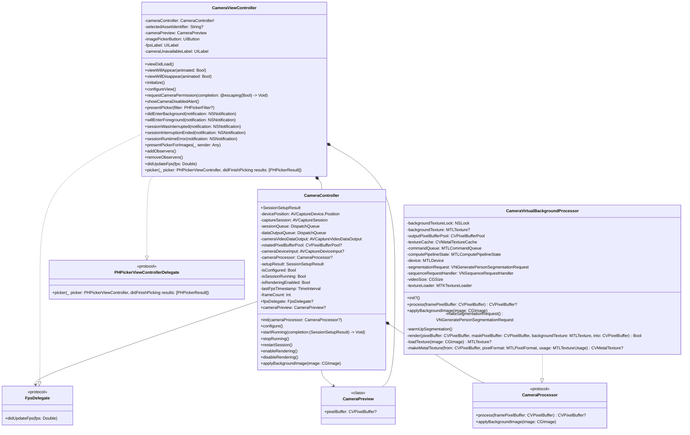

# Sample application to apply custom virtual backgrounds

## Table of Contents

1. [Introduction](#introduction)
2. [Class Diagram](#class-diagram)
3. [Camera Capturing](#camera-capturing)
4. [Camera Preview Rendering](#camera-preview-rendering)
5. [Applying Virtual Background](#applying-virtual-background)
6. [Demo](#demo)

## Introduction

This project leverages Apple's Vision person segmentation to replace the background in real-time on iOS devices. Using an on-device deep learning model, it accurately detects and segments the human figure, allowing users to apply custom virtual backgrounds. The segmentation mask is then refined along the edges using the camera image itself, so the outline follows the person closely. Optimized for performance, it ensures smooth processing on mobile devices.

## Class Diagram

## Camera Capturing

Camera capturing for iOS utilizes the `AVFoundation` framework to manage and configure the camera hardware, capture video and audio data, and process the captured data. The `CameraController` class is responsible for setting up capture session (`AVCaptureSession`) it's the core component that manages the flow of data from the input devices (camera and microphone) to the outputs (video and audio data). 

In this implementation, the controller focuses solely on video capture. It starts with setting up the capture session on a background queue (`sessionQueue`), configures the session preset, adds the camera input, and sets up the video data output. Configuration happens only once, even if the view appears multiple times. The `startRunning` and `stopRunning` methods start and stop the capture session on the `sessionQueue`. Because `startRunning` runs on the same queue as configuration, it always reports the final setup result, which is delivered to its completion handler on the main queue.

If an iOS version ignores the requested portrait rotation and delivers landscape frames, the controller rotates them to portrait with `vImage`, using a reusable pixel buffer pool, before passing them on.

Each time a new video frame is captured, the `captureOutput` method is triggered, processing the frame and updating the frames per second (FPS) in real time.

## Camera Preview Rendering

The `CameraPreview` class is a custom `MetalKit` view that renders video frames captured by the camera. It manages the `Metal` device, command queue, render pipeline state, and texture cache. The class handles the creation of `Metal` textures from pixel buffers, sets up the necessary transformations for rendering, and encodes the rendering commands. The draw method is responsible for rendering the video frames on the screen, and the `setupTransform` method scales the frame to fill the view while preserving its aspect ratio, recalculating whenever the texture dimensions or view bounds change.

The `PassThrough.metal` file contains the vertex and fragment shaders used by the `CameraPreview` class to render video frames. The vertex shader processes the vertex positions and texture coordinates, while the fragment shader samples the texture to determine the color of each pixel. The `CameraPreview` class sets up the render pipeline state with these shaders, prepares the vertex and texture coordinate buffers, and issues draw commands to render the video frames using `Metal`. This setup allows for efficient and high-performance rendering of video frames captured by the camera.

## Applying Virtual Background

The `CameraVirtualBackgroundProcessor` class is responsible for processing video frames to apply a virtual background using `Vision` and `Metal`. It implements the `CameraProcessor` protocol, which defines methods for processing video frames and applying a background image. The implementation uses Vision's `VNGeneratePersonSegmentationRequest` to separate the foreground (a person) from the background in video frames. Vision runs Apple's on-device person segmentation model and returns a soft mask, which a compute shader uses to blend the camera frame with a virtual background image. Frames, masks, and output buffers are shared with the GPU without copying, making it suitable for applications such as virtual backgrounds in video conferencing or live streaming.

Here’s how it works:

1. **Initialization**: This initializer sets up a Metal-based image processing pipeline. It creates a `Metal` device and command queue, loads the `mixer` compute shader from the `Mixer.metal` file, and sets up a compute pipeline. A texture cache is initialized to wrap pixel buffers as `Metal` textures without copying their memory, and a pixel buffer pool is created so output frames reuse memory instead of being allocated on every frame. Finally, it warms up person segmentation on a background queue by running it once on a blank frame, so Vision loads its model before the first real frame without delaying app launch.

2. **Configuring Person Segmentation**: The segmentation request uses the `.balanced` quality level, which Apple recommends for live video (`.accurate` is intended for still images and is too slow for real-time use), and outputs a single-channel 8-bit mask (`kCVPixelFormatType_OneComponent8`). Unlike a general semantic segmentation model, which assigns every pixel one of many class labels, Vision's person segmentation is specialized for people and produces a matte: each pixel holds a value from `0` (background) to `1` (person), with intermediate values along soft edges such as hair. The same request is reused for every frame and performed through a `VNSequenceRequestHandler`, which keeps state between frames and produces a more temporally stable mask than one-off requests.

3. **Generating the Segmentation Mask**: The `process` method checks if `backgroundTexture` is available. If it isn't, it returns `framePixelBuffer`, which represents the frame captured by the camera, unchanged. Otherwise, it performs the segmentation request directly on the camera frame (Vision handles any scaling internally) and reads the resulting mask from the request's results as a `CVPixelBuffer`.

4. **Rendering the Frame**: The `render` method wraps the camera frame, the segmentation mask, and an output pixel buffer taken from the pool as `Metal` textures, dispatches the `mixer` compute kernel, and waits for the GPU to finish. The background texture is guarded by a lock, because it's set from the main thread when the user picks an image while frames are processed on the camera's data output queue.

5. **Blending and Refining the Edges**: The compute shader in `Mixer.metal` reads the mask value at each pixel to get the person coverage. Pixels that are clearly person or clearly background are used as they are. Along the edge, where the mask is uncertain, the shader refines the coverage with a joint bilateral filter guided by the camera image: it samples a small neighbourhood of pixels and gives more weight to neighbours that are both close by and similar in color to the current pixel. This makes the edge snap to where the color actually changes in the camera image instead of following the lower-resolution mask, and a final contrast step tightens the transition. The camera pixel and the background are then blended by the resulting coverage. The tuning parameters (`REFINE_RADIUS`, `COLOR_SIGMA`, `EDGE_LOW`, `EDGE_HIGH`, and others) are constants at the top of the shader.

6. **Displaying the Frame**: Because the shader writes directly into the output pixel buffer, no copy is needed afterwards. The `process` method returns that pixel buffer for displaying on the screen using the `CameraPreview` class, the process of which was explained in the Camera Preview Rendering section.

Note that Vision person segmentation requires a physical device; it doesn't work properly in the iOS Simulator.

## Demo

https://github.com/user-attachments/assets/96686316-3284-41f2-9f14-97fa5197d0da

## Like This Project? Fuel It with a Coffee! ☕

